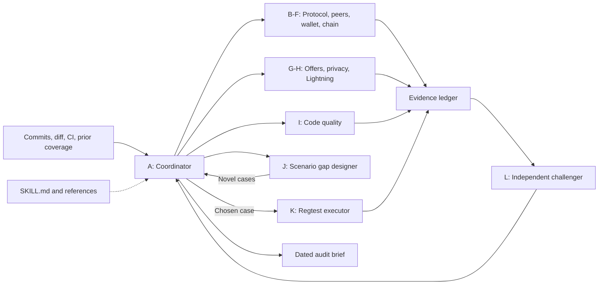
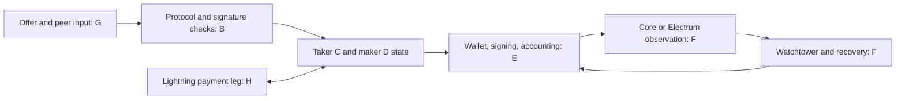
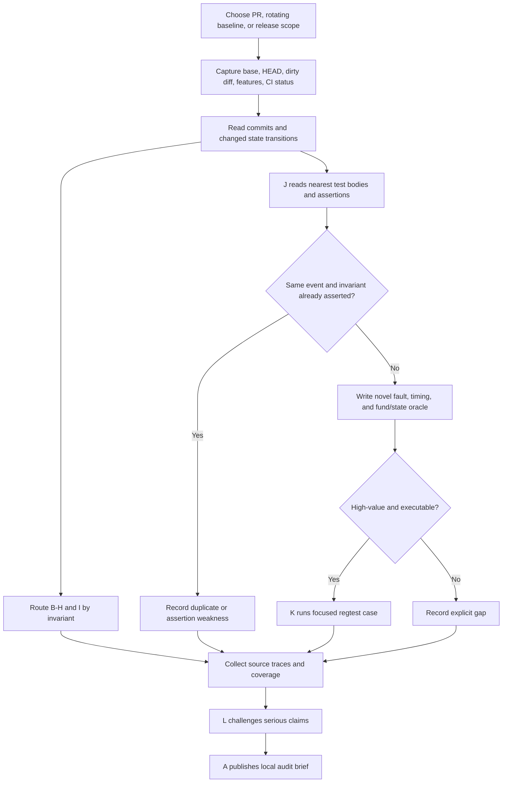

# OpenSwap audit architecture

> **Goal:** Repeatedly test whether OpenSwap keeps funds recoverable, swap outcomes atomic, accounting correct, and privacy assumptions intact as the code changes. This page is the human-facing map; the [audit skill](skills/openswap-audit/SKILL.md) contains the instructions an agent follows.

This workflow combines code review with deliberately chosen regtest scenarios. It starts from recent commits and the tests CI already runs, then asks what failure boundary is still unproved. A clean CI run is useful evidence for its exact assertions; it is not a substitute for checking adversarial behavior, persistence, recovery, and cross-module state.

## Run with Pi

Install [Pi](https://pi.dev/docs/latest/quickstart) and configure a model first. Pi supports local open-source models through [llama.cpp or a compatible endpoint](https://pi.dev/docs/latest/models#connect-local-models). This repository is a [Pi package](https://pi.dev/docs/latest/packages): one load supplies both the skill and the extension that creates independent reviewer processes.

Install this repository as a Pi package, then open Pi in the OpenSwap source checkout:

```sh
pi install git:github.com/0xEgao/openswap-audit-skills
cd /path/to/openswap
pi
```

At the Pi prompt, select the configured model with `/model` if needed, then run:

```text
/openswap-audit Audit recent commits against origin/master, including dirty changes.
```

The command also accepts a release or module scope, for example `/openswap-audit Release audit of all P0 lanes and enabled Lightning` or `/openswap-audit Audit recent watchtower changes and their wallet recovery boundary`.

While editing this sibling repository locally, you can load it without installing or pushing:

```sh
cd /path/to/openswap
pi -e ../openswap-audit-skills
```

To install only for the OpenSwap checkout, run `pi install --local git:github.com/0xEgao/openswap-audit-skills` there. Project-local packages load after project trust is granted. Run `pi update --extensions` to update the managed Git package. See [Pi package documentation](https://pi.dev/docs/latest/packages) for scope and update behavior.

`/openswap-audit` makes the current Pi session role **A**, the coordinator. It reads the exact checkout and CI assertions, chooses affected reviewers from B–H, then invokes the package's `openswap_audit_agents` tool in small waves. I (code quality) and J (novel scenario design) run on change audits. The tool starts separate read-only Pi processes with the selected model and returns their reports. It runs one worker at a time by default for a single local model backend; the coordinator can request up to four parallel workers when the backend supports them. L challenges serious findings. K runs only a chosen new scenario in a fresh detached worktree through `openswap_audit_scenario`; source changes must be committed so K tests the audited HEAD (the project-local `.pi/settings.json` is exempt). The worktree and patch are kept for inspection. The coordinator produces the dated audit and coverage ledger in the Pi conversation.

The review workers use Pi's read/search tools. K can edit and run focused regtest commands in its worktree. Pi extensions and tools run with your account's permissions; the worktree is [not an OS sandbox](https://pi.dev/docs/latest/security). Use a container or restricted account if auditing untrusted code. A selected model, reachable backend, and regtest dependencies are prerequisites for model calls and scenario execution. A missing dependency is reported as blocked, not as a passing audit.

The source paths below refer to the target OpenSwap checkout. Its current Git state, CI workflow, integration-test README, and tests are the authority for each audit, even when this documentation uses an earlier example.

## Architecture at a glance



The [Pi extension](extensions/openswap-audit.mjs) starts separate reviewer processes when the coordinator calls its tool. Markdown defines the roles, routing, and handoffs. Each worker receives the same Git snapshot and a distinct question. The coordinator runs waves with concurrency limited to suit the selected model backend.

## What the specialists review

The critical path is a sequence of trust and state boundaries. The reviewer assigned to one box follows the data into neighboring boxes rather than stopping at a directory boundary.



| Boundary | Invariant to review | Typical source area |
| --- | --- | --- |
| Offer and message to validation | An untrusted peer cannot change terms or gain a reserve before checks complete. | `src/taker/offers.rs`, `src/maker/handlers.rs`, `src/protocol/` |
| Validation to signature or broadcast | Signatures bind the intended amount, outpoint, script, role, and locktime; funded outputs have exits. | `src/protocol/`, maker/taker verification |
| Peer state to durable wallet state | A crash or retry cannot forget a funded coin, duplicate a payment, or release a live reserve. | `src/{maker,taker}/api.rs`, `src/wallet/` |
| Wallet to chain observation | Replacements, reorgs, backend lag, and fee limits cannot create false finality or strand a version. | `src/wallet/blockchain/`, `src/watch_tower/` |
| Chain or payment failure to recovery | Every still-live funded position remains discoverable, spendable, and eventually retired correctly. | `src/watch_tower/`, maker/taker recovery, `src/lightning/` when enabled |

The [module priority map](skills/openswap-audit/references/module-priorities.md) selects the primary and complementary reviewer for a changed boundary. The [full agent briefs](skills/openswap-audit/references/agent-briefs.md) give exact paths, questions, nearby tests, and required evidence.

### Role catalogue

| Role | Job | Activated when |
| --- | --- | --- |
| **A Coordinator** | Capture snapshot, assign distinct questions, integrate and challenge evidence. | Every audit |
| **B Contract and signature** | Review spend paths, transaction binding, nonce/signature checks, Legacy and Taproot differences. | Protocol or verification changes; every release |
| **C Taker state and route** | Review hop ordering, retries, funding, abort, final-hop cleanup. | Taker flow or route changes |
| **D Maker admission and state** | Review peer validation, reservations, concurrency, signing, and cleanup. | Maker or message-handling changes |
| **E Wallet and accounting** | Review persistence, outpoint ownership, fees, balances, backup and restore. | Wallet/funding changes; every release |
| **F Chain, watchtower and recovery** | Review Core/Electrum visibility, reorgs, missed watches, refunds and claims. | Chain/recovery changes; every release |
| **G Offer, fidelity and privacy** | Review stale or malicious offers, bond evidence, network and information leakage. | Marketplace, transport or privacy changes |
| **H Lightning atomicity** | Review payment versus on-chain settlement, invoice binding and crash windows. | Lightning enabled or changed |
| **I Code quality** | Find concrete error-path, concurrency, duplication, logging and test-assertion defects. | Every change audit |
| **J Scenario gap designer** | Compare recent commits with exact CI test assertions; propose only new edge cases. | Every change audit |
| **K Scenario executor** | Run one selected new case or reproduction in an isolated disposable regtest world. | Only when a material question needs execution |
| **L Independent challenger** | Try to falsify serious findings and check alternative safe paths. | High-impact or disputed findings |

## How one audit runs



The scenario designer should inspect recent commits **one by one**. For each changed transition it records the invariant, nearest existing test and its actual assertions, then the specific ordering, value, protocol/backend, or restart boundary still unproved. A proposed test specifies the injected event and observable transaction, UTXO, wallet state, balance/fee, and terminal outcome. The [scenario procedure](skills/openswap-audit/references/scenario-selection.md) has the worksheet and a funding-replacement example.

CI at the documented OpenSwap snapshot runs default-feature integration tests in eight nextest partitions plus a separate Tor lane. Its main integration command does not enable the optional Lightning module. The designer avoids routinely rerunning those existing tests; the executor runs a narrow case when it can answer a material question. Before each audit, read the target checkout's integration-test README and CI workflow for the actual commands and feature coverage.

## Priority and cadence

1. **Every substantial PR or branch:** start with newly changed fund-safety or recovery invariants, their cross-module dependencies, an independent code-quality pass, and the highest-value novel scenario briefs.
2. **Periodic baseline rotation:** revisit a P0 invariant that recent diffs did not touch, prioritizing old gaps and assumptions that have not been challenged recently.
3. **Before a security-sensitive release:** cover contracts, both peer state machines, wallet/accounting, chain/recovery, and every enabled money-moving feature. Record any remaining high-impact gaps explicitly.

P0 is about possible fund loss, broken atomicity, or lost recovery. Changed funding replacement, signing, wallet persistence, and watchtower behavior usually move to the first wave. Offer/fidelity/privacy and operational resilience can move up when they affect a P0 boundary. The [routing rules](skills/openswap-audit/references/module-priorities.md) give the detailed map.

## Deliverables and handoffs

Every specialist returns reviewed paths, the invariant and threat model, exact source lines, an ordered trigger-to-impact trace for candidates, tests or code evidence, competing explanations, and coverage gaps. The coordinator separates confirmed findings from hypotheses, asks the challenger to inspect serious claims, and writes one dated brief with a coverage ledger and scenario outcomes. The [finding and scenario templates](skills/openswap-audit/references/finding-format.md) keep reports comparable across runs.

The ledger distinguishes **existing CI assertion**, **reviewed without a finding**, **new scenario executed**, **blocked**, and **unreviewed**. It is carried into the next audit along with unresolved questions and duplicate scenarios already discarded.

## Repository files

| File | Purpose |
| --- | --- |
| [package.json](package.json) | Pi package manifest: skill and extension |
| [extensions/openswap-audit.mjs](extensions/openswap-audit.mjs) | `/openswap-audit` command and isolated reviewer/scenario tools |
| [skills/openswap-audit/SKILL.md](skills/openswap-audit/SKILL.md) | Audit entry point and coordinator workflow |
| [skills/openswap-audit/references/agent-briefs.md](skills/openswap-audit/references/agent-briefs.md) | A-L specialist assignments |
| [skills/openswap-audit/references/module-priorities.md](skills/openswap-audit/references/module-priorities.md) | Module priority and dispatch rules |
| [skills/openswap-audit/references/scenario-selection.md](skills/openswap-audit/references/scenario-selection.md) | Commit-driven scenario discovery |
| [skills/openswap-audit/references/finding-format.md](skills/openswap-audit/references/finding-format.md) | Finding, scenario, and coverage templates |

All links in this README are relative to the repository and work when the repository is browsed on GitHub. Mermaid blocks provide the diagrams; the adjacent text and tables carry the same structure in renderers that show them as code.

## Use the brief with another agent runner

In the target OpenSwap checkout, ask an agent:

> Use the OpenSwap audit skill to audit this branch against its merge base, including dirty changes. Read recent commits individually. Select the affected specialist roles, compare the changed behavior with actual CI test assertions, propose novel edge cases, and execute a focused case only when it resolves a material uncertainty. Give code-quality and serious-finding challenge passes. Return the dated coverage ledger, verified findings, and unresolved gaps.

The skill is the operational instruction; this page is the architecture and navigation map.
